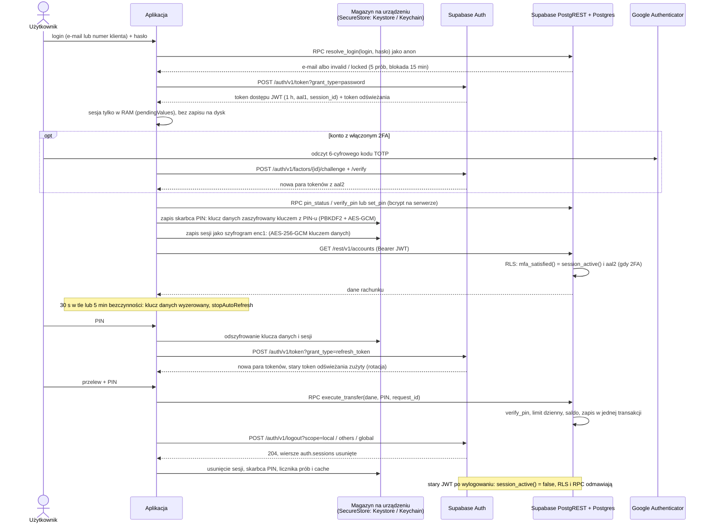

# Raport: logowanie i sesje — SecureBank

| Pole | Wartość |
| :--- | :--- |
| **Aplikacja** | SecureBank, `com.securebank.app` (React Native, Expo SDK 58, TypeScript) |
| **Backend** | Supabase: Auth (GoTrue), PostgREST, PostgreSQL z RLS |
| **Obszar MASVS** | MASVS-AUTH-1, MASVS-AUTH-2, MASVS-AUTH-3, MASVS-STORAGE-1 |
| **Stan bazowy („u nas teraz”)** | commit `72c1dee` |
| **Stan po poprawkach („docelowo”)** | zmiany Z6 w kodzie aplikacji, `supabase/schema.sql` i migracji `supabase/migrations/z6_sesje.sql` |
| **Testy** | `scripts/session-check.mjs` (`npm run test:sessions`), przegląd kodu, zapytania do API Supabase |

Oznaczenia dowodów: `plik:linia` odnosi się do stanu po poprawkach, a `72c1dee:plik:linia` do stanu bazowego. Identyfikatory testów (np. `D2`) to przypadki w `scripts/session-check.mjs`.

Źródła:

* **[SB-SES]** Supabase, *User sessions*: <https://supabase.com/docs/guides/auth/sessions>
* **[SB-RL]** Supabase, *Rate limits*: <https://supabase.com/docs/guides/auth/rate-limits>
* **[SB-JWT]** Supabase, *JSON Web Tokens*: <https://supabase.com/docs/guides/auth/jwts>
* **[SB-PWD]** Supabase, *Passwords*: <https://supabase.com/docs/guides/auth/passwords>
* **[SB-HOOK]** Supabase, *Password verification hook*: <https://supabase.com/docs/guides/auth/auth-hooks/password-verification-hook>
* **[RTS]** Rozporządzenie delegowane Komisji (UE) 2018/389 (RTS do PSD2, silne uwierzytelnianie klienta): art. 4 ust. 3 lit. b (najwyżej 5 nieudanych prób), art. 4 ust. 3 lit. d (najwyżej 5 minut bezczynności), art. 4–5 (uwierzytelnienie i powiązanie z kwotą i odbiorcą przy płatności)
* **[MASVS]** OWASP MASVS v2, kategoria MASVS-AUTH; OWASP MASTG
* **[OWASP-AUTH]** OWASP Authentication Cheat Sheet (blokada konta, jednakowe komunikaty błędów)
* **[OWASP-FP]** OWASP Forgot Password Cheat Sheet
* **[D5]** `docs/storage/polityka-sesji.md`

---

## 1.1 Elementy sesji

### Diagram sekwencji logowania

Na diagramie są wszystkie wymagane elementy:

* **Logowanie:** hasło (opcjonalnie z TOTP), odpowiedź serwera to para tokenów.
* **Zapis na urządzeniu:** skarbiec PIN i szyfrogram sesji w SecureStore.
* **Zwykłe zapytanie:** nagłówek `Authorization: Bearer <JWT>`.
* **Wygaśnięcie:** automatyczne odświeżanie przez supabase-js z rotacją tokenu odświeżania.
* **Koniec sesji:** `/logout` po stronie serwera i czyszczenie magazynu po stronie aplikacji.

Zewnętrznego dostawcy tożsamości nie ma, bo Supabase Auth ma włączony wyłącznie dostawca `email` (`GET /auth/v1/settings`, `external`). Google Authenticator nie jest dostawcą tożsamości, tylko generatorem kodów TOTP.

### Tabela elementów sesji

| Element | Gdzie powstaje | Gdzie leży | Ważny przez | Jak unieważnić | Problem | Decyzja i źródło |
| :--- | :--- | :--- | :--- | :--- | :--- | :--- |
| **Hasło** | Użytkownik, przy rejestracji (`src/screens/LoginScreen.tsx:256`) | Serwer: skrót bcrypt w `auth.users.encrypted_password`; aplikacja tylko w RAM formularza | Do zmiany przez użytkownika | Zmiana w ustawieniach (`src/components/SettingsModal.tsx:408`) | Przed Z6: brak limitu nieudanych prób na konto (tylko limit IP Supabase) oraz anonimowa funkcja `lookup_email_by_client_number` ujawniająca e-mail po numerze klienta (`72c1dee:supabase/schema.sql:109`) | Decyzja 5: `resolve_login` (`supabase/schema.sql:558`), 5 prób i blokada 15 min, funkcja ujawniająca e-mail usunięta. [RTS] art. 4 ust. 3 lit. b, [OWASP-AUTH] |
| **Token dostępu (JWT)** | Supabase Auth po `/token` | RAM klienta supabase-js; na dysku tylko w szyfrogramie `enc1:` (`src/services/supabase.ts:107`) | 3600 s (domyślnie [SB-SES]; sprawdza test `P1`) | Przed Z6: nie da się, działał do `exp` także po wylogowaniu. Po Z6: usunięcie wiersza `auth.sessions` (wylogowanie, reuse detection) | Skradziony token dawał dostęp do danych przez resztę godziny po wylogowaniu | Decyzja 1: `session_active()` w `mfa_satisfied()` (`supabase/schema.sql:170`, `:182`) — każde zapytanie sprawdza, czy sesja nadal istnieje. [SB-SES] („check that the session_id claim … corresponds to a row in the auth.sessions table”) |
| **Token odświeżania** | Supabase Auth po `/token` | Szyfrogram `enc1:` w SecureStore (`src/services/supabase.ts:107`), klucz danych tylko w RAM po podaniu PIN-u | Bez wygaśnięcia, jednorazowy, rotowany przy każdym użyciu [SB-SES] | `signOut` (`App.tsx:220`), wykrycie ponownego użycia (cała sesja odwołana), „Wyloguj pozostałe / wszędzie” | Nie wygasa sam; limit czasu sesji i bezczynności po stronie serwera wymaga planu Pro [SB-SES] | Decyzja 6: lista sesji i wylogowanie innych urządzeń; reuse detection pozostaje włączone (testy `A1`–`A3`) |
| **Kod i sekret TOTP** | Sekret: Supabase przy `mfa.enroll` (`src/services/mfa.ts:99`); kod: Google Authenticator | Sekret: serwer i aplikacja Authenticator; w SecureBank tylko chwilowo w schowku (czyszczony po 60 s) | Kod: okno 30 s; sekret: do wyłączenia 2FA | `mfa.unenroll` (`src/services/mfa.ts:126`) | Limit prób weryfikacji tylko po IP: 15/min [SB-RL] | Bez zmian w Z6; ograniczenia schowka z Z5 (K2) |
| **PIN (serwerowy)** | Użytkownik; `set_pin` (`supabase/schema.sql:279`) | Skrót bcrypt w `user_pins` (`supabase/schema.sql:219`), tabela niedostępna przez API | Do zmiany lub resetu | `set_pin`, reset po 5 błędach (`supabase/schema.sql:270`) | Przed Z6 nie był wymagany przy przelewie ani zmianie limitu | Decyzja 2: przelew i podwyższenie limitu wymagają PIN-u weryfikowanego na serwerze. [RTS] art. 4–5, [MASVS] MASVS-AUTH-3 |
| **Skarbiec PIN i klucz danych sesji** | Aplikacja: losowy klucz 256 bit, opakowany kluczem z PIN-u (`src/services/pin.ts:115`) | Skarbiec w SecureStore (`WHEN_UNLOCKED_THIS_DEVICE_ONLY`, `src/services/supabase.ts:22`); klucz danych tylko w RAM | Do blokady (30 s w tle, 5 min bezczynności) albo wylogowania | `lockSession` (`src/services/pin.ts:98`), `deletePinVault` (`src/services/pin.ts:178`), 5 błędnych PIN-ów | 6 cyfr to 10⁶ kombinacji; ochrona opiera się na limicie prób i Keystore | Bez zmian w Z6 (decyzje Z4/Z5); nowa blokada po bezczynności (decyzja 4) |
| **Sesja serwerowa (`auth.sessions`, `session_id`)** | Supabase Auth przy logowaniu | Serwer; identyfikator w JWT | Do wylogowania lub wykrycia ponownego użycia tokenu | `/logout?scope=local/others/global` | Przed Z6 nikt jej nie sprawdzał przy dostępie do danych i użytkownik nie widział swoich sesji | Decyzje 1 i 6 (`supabase/schema.sql:629`, `my_sessions`) |
| **Licznik nieudanych logowań** | `resolve_login` | `login_attempts` (`supabase/schema.sql:548`), niedostępna przez API | Blokada 15 min po 5 błędach (`supabase/schema.sql:614`) | Poprawne logowanie zeruje licznik | Bezpośrednie wywołanie `/auth/v1/token` z pominięciem aplikacji omija licznik | Decyzja 5; docelowo hook weryfikacji hasła [SB-HOOK] |
| **Klucz idempotencji przelewu (`request_id`)** | Aplikacja (`src/components/TransferModal.tsx:86`) | RAM; na serwerze kolumna `transactions.request_id` z unikalnym indeksem (`supabase/schema.sql:394`) | Do zmiany danych formularza albo udanego przelewu | Nowy identyfikator przy edycji formularza | Ponowienie żądania po zerwanym połączeniu mogło wykonać przelew dwa razy | Decyzja 3 (zadanie K4 z Z5) |
| **Biometria** | — | — | — | — | Nie dotyczy: aplikacja świadomie nie używa biometrii (decyzja z Z4); odblokowanie PIN-em odszyfrowuje klucz, a nie sprawdza `true/false` | Decyzja 8 |

---

## 1.2 Scenariusze

„Przed” to stan `72c1dee`. „Po Z6” to stan po wdrożeniu decyzji z 1.4. Testy oznaczone identyfikatorem uruchamia `npm run test:sessions`. Wyniki należy wpisać do tabeli „Wyniki testów” poniżej.

| Scenariusz | Co powinno się stać | Co dzieje się u nas (przed → po Z6) | Jak sprawdziliśmy |
| :--- | :--- | :--- | :--- |
| **Wylogowanie** | Token odświeżania i token dostępu przestają działać natychmiast; dane sesji znikają z urządzenia [SB-SES], [D5] | **Przed:** „Wyloguj” z ekranu głównego tylko blokował aplikację; pełne wylogowanie było dostępne z ekranu PIN-u, gdzie sesja jest zaszyfrowana, więc `signOut` nie mógł unieważnić tokenu na serwerze; stary JWT działał do `exp`. **Po:** „Wyloguj z tego urządzenia” w ustawieniach przy odblokowanej sesji (`App.tsx:233`) unieważnia sesję (`scope=local`) i czyści magazyn (`src/services/deviceState.ts:19`); stary JWT traci dostęp przez `session_active()`. | Testy `D1`–`D3`; przegląd `App.tsx:218`; ręcznie: wylogowanie → zamknięcie aplikacji → ekran logowania |
| **Zgubiony telefon** | Złodziej bez PIN-u nie ma dostępu; właściciel z innego urządzenia kończy sesję zgubionego telefonu | **Przed:** sesja szyfrowana kluczem z PIN-u, 5 prób i wymazanie skarbca (`src/services/pin.ts:146`), ale brak możliwości zdalnego zakończenia sesji z aplikacji. **Po:** dodatkowo lista sesji i „Wyloguj pozostałe urządzenia” (`src/components/SettingsModal.tsx:225`); odwołana sesja natychmiast traci dostęp do danych (decyzja 1). | Test `C1` (dwie sesje, `scope=others`); przegląd `src/services/pin.ts:146` |
| **Zmiana hasła** | Pozostałe sesje kończą się; zmiana wymaga obecnego hasła [OWASP-AUTH] | **Przed i po:** wymagane obecne hasło (`src/components/SettingsModal.tsx:398`), potem `signOut({ scope: 'others' })` (`src/components/SettingsModal.tsx:417`). **Przed:** inne urządzenia zachowywały dostęp do danych do wygaśnięcia JWT (do 1 h). **Po:** dostęp kończy się od razu (decyzja 1). | Przegląd kodu; mechanizm identyczny jak w teście `C1` |
| **Token wygasa w trakcie pracy** | Aplikacja odświeża token bez udziału użytkownika; po unieważnieniu sesji przechodzi do logowania | **Przed i po:** `autoRefreshToken: true` (`src/services/supabase.ts:142`); po blokadzie odświeżanie jest zatrzymywane (`App.tsx:169`) i wznawiane po PIN-ie; nieudane odświeżenie emituje `SIGNED_OUT`, a strażnik `gate` przechodzi do logowania [D5]. | Test `S4` (rotacja tokenu); ręcznie: unieważnienie sesji w panelu Supabase → odblokowanie PIN-em → ekran logowania |
| **Reinstalacja aplikacji** | Sesja nie wraca po usunięciu i ponownej instalacji [D5] | **Przed i po:** Android usuwa SecureStore z aplikacją; iOS: brak pliku flagi w `documentDirectory` powoduje wyczyszczenie Keychain przed pierwszym ekranem (`src/services/deviceState.ts:27`, `App.tsx:92`). Osierocona sesja serwerowa: po Z6 widoczna na liście sesji i możliwa do zakończenia przez „Wyloguj pozostałe urządzenia”. | Ręcznie: zalogowanie → usunięcie aplikacji → instalacja → ekran logowania (nagranie z Z5) |
| **Przechwycony token** | Krótka użyteczność, brak możliwości wykonania operacji krytycznych bez dodatkowego uwierzytelnienia [MASVS] MASVS-AUTH-3 | **Przed:** JWT ważny do `exp` mimo wylogowania; dowolny zapis do `transactions` i tworzenie rachunku z dowolnym saldem przez RLS `accounts_insert_own` (`72c1dee:supabase/schema.sql:81`); przelew bez PIN-u. **Po:** odwołanie sesji działa natychmiast; bezpośrednie zapisy zablokowane (`supabase/schema.sql:382`, `:545`); przelew i podwyższenie limitu wymagają PIN-u znanego tylko użytkownikowi (`supabase/schema.sql:352`, `:397`). | Testy `T1`, `T2`, `R1`, `D2` |
| **Ponowne użycie tokenu odświeżania** (zadanie A) | Ponowne użycie zużytego tokenu kończy całą sesję [SB-SES], RFC 9700 | **Stan faktyczny na serwerze Supabase:** rotacja tokenów działa (`S4`) i ponowne użycie starego tokenu po `12 s` jest odrzucane z `HTTP 400 refresh_token_already_used` (`A1`), jednak nasz projekt Supabase wydaje 12-znakowe tokeny `v1`, w których mimo włączonego wykrywania w panelu (`10 s`) aktualny token `R2` i wiersz `auth.sessions` nie zostały unieważnione (`A2`, `A3` FAIL). Po stronie bazy `session_active()` działa poprawnie dla każdego wylogowania (`D2`, `C1`). | Testy `A1`–`A3` (`A1` PASS; `A2`, `A3` FAIL — opis poniżej) |
| **Logowanie u zewnętrznego dostawcy** | — | Nie dotyczy: włączony wyłącznie dostawca `email` (`GET /auth/v1/settings`), brak OAuth i WebView w kodzie | Zapytanie do `/auth/v1/settings`; przegląd `src/` |
| **Logowanie biometrią** (zadanie B) | Biometria powinna odblokowywać klucz w sprzęcie, a nie zwracać `true/false` | Nie dotyczy: biometrii nie używamy. Odpowiednikiem jest PIN, który odszyfrowuje klucz danych sesji (PBKDF2 → AES-GCM, `src/services/pin.ts:146`); błędny PIN nie daje klucza, więc podmiana wyniku funkcji nic nie daje | Przegląd `src/services/pin.ts` |
| **Odgadywanie hasła** | Najwyżej 5 nieudanych prób, potem blokada [RTS] art. 4 ust. 3 lit. b | **Przed:** tylko limit IP Supabase (150 żądań `/token` na 5 min [SB-RL]). **Po:** 5 prób na identyfikator, blokada 15 min (`supabase/schema.sql:558`). | Test `L2` |
| **Ustalenie e-maila klienta po numerze** | Brak możliwości bez znajomości hasła [OWASP-AUTH] | **Przed:** anonimowe `lookup_email_by_client_number` zwracało e-mail (HTTP 200 dla wywołania z kluczem anon). **Po:** funkcja usunięta; `resolve_login` zwraca e-mail wyłącznie po poprawnym haśle i ten sam komunikat dla nieistniejącego konta. | Test `L1`; wywołanie z kluczem anon przed migracją: HTTP 200 |
| **Powtórzony przelew** | Ponowienie tego samego zlecenia nie obciąża rachunku drugi raz | **Przed:** brak ochrony. **Po:** `request_id` z unikalnym indeksem; powtórzenie zwraca wynik pierwszego wykonania (`duplicate: true`). | Przegląd `supabase/schema.sql:397`; ręcznie: dwa wywołania RPC z tym samym `p_request_id` |

### Wyniki testów

Uruchomiono `npm run test:sessions` po wgraniu migracji `supabase/migrations/z6_sesje.sql` oraz włączeniu `Confirm email` w panelu Supabase (`GET /auth/v1/settings` zwraca `mailer_autoconfirm: false`): **13/15 PASS** (2 odstępstwa po stronie serwera Supabase Auth dla tokenów odświeżania `v1`).

| Test | Co sprawdza | Oczekiwane | Wynik |
| :--- | :--- | :--- | :--- |
| `P1` | Ważność JWT i obecność `session_id` | 3600 s, `session_id` jest | **PASS** — `3600 s, session_id=jest` |
| `S0` | Zwykłe zapytanie | 1 wiersz rachunku | **PASS** — `1` |
| `S4` | Rotacja tokenu odświeżania | nowy token przy każdym użyciu | **PASS** — `HTTP 200, tokeny rozne` |
| `A1` | Ponowne użycie starego tokenu odświeżania po 12 s | HTTP 400 | **PASS** — `HTTP 400 refresh_token_already_used` |
| `A2` | Aktualny token po wykryciu ponownego użycia | HTTP 400 | **FAIL** — `HTTP 200` (mimo `10 s` i włączonego wykrywania w panelu Supabase aktualny 12-znakowy token `v1` pozostał aktywny; powtórzono z równym wynikiem także po `22 s` i z nagłówkiem `sb-auth-refresh-token-reuse: false`) |
| `A3` | JWT sesji odwołanej przez reuse detection | 0 wierszy | **FAIL** — `1` (w konsekwencji `A2`, a także ponieważ w `supabase/auth` ścieżka `v1` `RevokeTokenFamily` nie wywołuje `LogoutSession` na `auth.sessions`, inaczej niż przy wylogowaniu w `D2` i `C1`) |
| `D1` | Stary JWT po wylogowaniu: `/auth/v1/user` | 401 / 403 | **PASS** — `logout HTTP 204, /user HTTP 403` |
| `D2` | Stary JWT po wylogowaniu: dane | przed 1, po 0 | **PASS** — `przed: 1, po: 0` |
| `D3` | Stary JWT po wylogowaniu: RPC | `not_authorized` | **PASS** — `HTTP 400 not_authorized` |
| `C1` | „Wyloguj pozostałe urządzenia” | inna sesja 0 wierszy, bieżąca 1 | **PASS** — `sesji przed: 3, inna: 0, biezaca: 1` |
| `T1` | Bezpośredni zapis przelewu | 401 / 403 | **PASS** — `HTTP 403` |
| `T2` | Bezpośrednie utworzenie rachunku | 401 / 403 | **PASS** — `HTTP 403` |
| `R1` | Przelew z błędnym PIN-em | `pin_invalid` | **PASS** — `pin_invalid` |
| `L1` | Anonimowe pobranie e-maila | 404 | **PASS** — `HTTP 404` |
| `L2` | 6 prób z błędnym hasłem | `locked` | **PASS** — `locked retry_after=900` |

---

## 1.3 Polityka sesji

| Parametr | U nas teraz (`72c1dee`) | Docelowo (po Z6) | Uzasadnienie i źródło |
| :--- | :--- | :--- | :--- |
| **Ważność tokenu dostępu** | 3600 s (domyślne ustawienie projektu) | 3600 s, ale odwołanie sesji działa natychmiast dzięki `session_active()` | [SB-SES]: domyślne 1 h jest zalecane, a wartości poniżej 5 min odradzane. Skoro unieważnienie egzekwujemy po stronie bazy, skracanie JWT nie daje dodatkowej ochrony danych, a zwiększa liczbę odświeżeń (decyzja 1) |
| **Ważność tokenu odświeżania** | Bez wygaśnięcia; jednorazowy; okno ponownego użycia 10 s; wykrywanie ponownego użycia włączone | Bez zmian po stronie Supabase. Lokalnie token tylko jako szyfrogram odblokowywany PIN-em; użytkownik może zakończyć sesje innych urządzeń | [SB-SES]: limity czasu sesji i bezczynności oraz pojedyncza sesja wymagają planu Pro. Kompensujemy je blokadą lokalną i wylogowaniem zdalnym (decyzje 4 i 6) |
| **Wylogowanie po bezczynności** | Blokada PIN-em po 30 s w tle (`App.tsx:196`); brak limitu na pierwszym planie | 30 s w tle oraz **5 min** bez dotknięcia ekranu na pierwszym planie (`src/services/activity.ts:1`, `App.tsx:211`) → blokada PIN-em, zerowanie klucza danych, zatrzymanie odświeżania | [RTS] art. 4 ust. 3 lit. d: najwyżej 5 min bezczynności po uwierzytelnieniu (decyzja 4) |
| **Limit nieudanych logowań** | Hasło: tylko limity IP Supabase (`/token` 150 / 5 min, burst 30); PIN: 5 prób lokalnie i 5 na serwerze; TOTP: 15 / min na IP | Hasło: **5** nieudanych prób na identyfikator (e-mail lub numer klienta) → blokada **15 min**; PIN i TOTP bez zmian | [RTS] art. 4 ust. 3 lit. b (najwyżej 5 prób), [SB-RL], [OWASP-AUTH] (decyzja 5) |
| **Operacje wymagające ponownego potwierdzenia** | Zmiana hasła (obecne hasło), zmiana PIN-u (obecny PIN), ustawienie PIN-u (logowanie hasłem w ciągu 15 min, `supabase/schema.sql:230`) | Jak obok oraz **przelew** i **podwyższenie dziennego limitu**: PIN sprawdzany na serwerze w tej samej transakcji co operacja; obniżenie limitu bez PIN-u | [RTS] art. 4–5, [MASVS] MASVS-AUTH-3 (decyzja 2) |
| **Kod lub link resetu hasła** | Brak funkcji resetu w aplikacji | Bez zmian w tej iteracji. Docelowo: `resetPasswordForEmail` z jednorazowym linkiem, limitem 60 s na użytkownika i komunikatem niezależnym od istnienia konta; po resecie `signOut({ scope: 'global' })` | [SB-PWD], [SB-RL], [OWASP-FP] (decyzja 9) |
| **Liczba aktywnych sesji i urządzeń** | Bez limitu, niewidoczna dla użytkownika | Bez limitu (pojedyncza sesja wymaga planu Pro); lista sesji z ostatnią aktywnością, „Wyloguj pozostałe urządzenia” i „Wyloguj wszędzie” | [SB-SES] (decyzja 6) |
| **Potwierdzenie adresu e-mail przy rejestracji** | Wyłączone (`mailer_autoconfirm: true` w `/auth/v1/settings`) | Włączone w panelu Supabase (Authentication → Sign In / Providers → Email → Confirm email) | Bez potwierdzenia można założyć konto na cudzy adres; reset hasła wymaga kontroli nad skrzynką [OWASP-FP] (decyzja 10) |

---

## 1.4 Decyzje

| Nr | Decyzja | Zmiana w kodzie | Dowód | Źródło |
| :---: | :--- | :--- | :--- | :--- |
| **1** | Każde zapytanie do danych i każde RPC sprawdza, czy sesja z `session_id` w JWT nadal istnieje. Wylogowanie, „wyloguj wszędzie”, zmiana hasła i wykrycie ponownego użycia tokenu odcinają dostęp natychmiast, a nie po wygaśnięciu JWT. | `session_active()` i nowe `mfa_satisfied()` (`supabase/schema.sql:170`, `:182`), używane przez restrykcyjne polityki RLS (`supabase/schema.sql:202`) i wszystkie RPC | Testy `A3`, `D2`, `D3`, `C1` | [SB-SES], [SB-JWT] |
| **2** | Przelew i podwyższenie dziennego limitu wymagają PIN-u sprawdzanego na serwerze w tej samej transakcji. Błędny PIN zwiększa serwerowy licznik prób; po 5 błędach PIN jest resetowany i aplikacja przechodzi do ścieżki „Nie pamiętam PIN-u”. | `execute_transfer` (`supabase/schema.sql:397`), `set_daily_limit` (`supabase/schema.sql:324`, `:348`); modal `src/components/PinConfirmModal.tsx`; `src/components/TransferModal.tsx:257`, `src/components/SettingsModal.tsx:186` | Test `R1`; ręcznie: przelew z błędnym PIN-em | [RTS] art. 4–5, [MASVS] MASVS-AUTH-3 |
| **3** | Przelew ma klucz idempotencji `request_id`; powtórzenie tego samego zlecenia zwraca wynik pierwszego wykonania. | Indeks `transactions_sender_request_id_key` (`supabase/schema.sql:394`); `src/components/TransferModal.tsx:86` | Przegląd kodu; ręcznie: dwa wywołania z tym samym `p_request_id` | Zadanie K4 z Z5; RFC 9110 (idempotencja) |
| **4** | Blokada aplikacji po 5 min bezczynności na pierwszym planie, niezależnie od blokady po 30 s w tle. | `src/services/activity.ts:1`; `App.tsx:211`, `App.tsx:329` (`onTouchStart`), modale przelewu, ustawień i PIN-u | Ręcznie: 5 min bez dotyku na ekranie głównym → ekran PIN-u | [RTS] art. 4 ust. 3 lit. d |
| **5** | Logowanie przechodzi przez `resolve_login`: 5 nieudanych prób na identyfikator, blokada 15 min, ten sam komunikat dla nieistniejącego konta, e-mail zwracany wyłącznie po poprawnym haśle. Usunięta anonimowa funkcja `lookup_email_by_client_number`. | `supabase/schema.sql:548`, `:558`; `src/services/login.ts:9`; `src/screens/LoginScreen.tsx:294` | Testy `L1`, `L2` | [RTS] art. 4 ust. 3 lit. b, [OWASP-AUTH] |
| **6** | Użytkownik widzi aktywne sesje i może zakończyć sesje pozostałych urządzeń albo wszystkie sesje (zadanie C). | `my_sessions` (`supabase/schema.sql:629`); `src/services/sessions.ts:12`; `src/components/SettingsModal.tsx:225`, `:239`; `App.tsx:238` | Test `C1` | [SB-SES] |
| **7** | Klient nie może sam tworzyć ani zmieniać profili, rachunków i transakcji. Profil i rachunek tworzy wyłącznie trigger `handle_new_user`, a przelew wyłącznie `execute_transfer`. | Usunięte polityki `profiles_insert_own`, `accounts_insert_own`, `transactions_insert_own`; `REVOKE` (`supabase/schema.sql:382`, `:545`); usunięte zapisy z `LoginScreen` (`72c1dee:src/screens/LoginScreen.tsx:281`) | Testy `T1`, `T2` | [MASVS] MASVS-AUTH-1 (autoryzacja po stronie serwera) |
| **8** | Biometrii nie wdrażamy (zadanie B). Odblokowanie PIN-em odszyfrowuje klucz danych sesji, więc nie jest decyzją `true/false`, którą można podmienić. | Bez zmian: `src/services/pin.ts:146` | Przegląd kodu | Decyzja z Z4 (PIN + TOTP); [MASVS] MASVS-AUTH-2 |
| **9** | Reset hasła odkładamy do kolejnej iteracji; zakres docelowy opisany w 1.3. | — | — | [SB-PWD], [OWASP-FP] |
| **10** | Ustawienia panelu Supabase: włączyć potwierdzanie e-maila; pozostawić włączone wykrywanie ponownego użycia tokenu (okno 10 s) i ważność JWT 3600 s. | Konfiguracja projektu, nie kod | `GET /auth/v1/settings` (`mailer_autoconfirm`), testy `P1`, `A1`–`A3` | [SB-SES] |

### Znane ograniczenia po Z6

* **Tokeny odświeżania `v1` w hostowanym Supabase a wykrywanie ponownego użycia (`A2`, `A3`).** Mimo ustawienia `10 s` i włączonego wykrywania w panelu Supabase projekt wydaje 12-znakowe tokeny `v1`; ponowne użycie starego tokenu po `12 s` i `22 s` zwraca `HTTP 400 refresh_token_already_used` (`A1`), ale nie unieważnia bieżącego tokenu `R2` ani wiersza `auth.sessions` (`A2`, `A3`). Dla jawnego wylogowania (`D2`, `C1`) `session_active()` odcina dostęp natychmiast.
* **Wylogowanie z ekranu PIN-u nie unieważnia sesji na serwerze.** Przy zablokowanej aplikacji token jest zaszyfrowany i bez PIN-u nie da się go użyć. Aplikacja usuwa wtedy szyfrogram i skarbiec, a sesja serwerowa zostaje osierocona. Można ją zakończyć z innego urządzenia przez „Wyloguj pozostałe urządzenia”. Wylogowanie z ustawień (decyzja 6) unieważnia sesję w pełni.
* **Limit prób z decyzji 5 da się obejść.** Bezpośrednie wywołanie `/auth/v1/token` pomija `resolve_login`, a wtedy działa tylko limit IP Supabase. Pełne egzekwowanie wymaga hooka weryfikacji hasła [SB-HOOK]. Dostępności hooka w naszym planie nie zweryfikowaliśmy.
* **Blokadą da się zaszkodzić właścicielowi konta.** Osoba znająca e-mail lub numer klienta może wywołać blokadę na 15 minut. To świadomy kompromis z [OWASP-AUTH]: blokada jest czasowa, a nie trwała.
* **Skrypt testowy wymaga konta bez 2FA.** Logowanie hasłem daje wtedy `aal1`, a polityki RLS z decyzji 1 odcinają konta z 2FA na poziomie `aal1`.

---

## Lista endpointów API aplikacji (K3)

| Endpoint | Metoda | Rola | Gdzie w kodzie | Cel |
| :--- | :--- | :--- | :--- | :--- |
| `/auth/v1/signup` | POST | anon | `src/screens/LoginScreen.tsx:256` | Rejestracja |
| `/auth/v1/token?grant_type=password` | POST | anon | `src/screens/LoginScreen.tsx:275`, `:311`; `src/components/SettingsModal.tsx:398` | Logowanie hasłem, potwierdzenie obecnego hasła |
| `/auth/v1/token?grant_type=refresh_token` | POST | anon + token odświeżania | supabase-js, `autoRefreshToken` (`src/services/supabase.ts:142`) | Odświeżenie pary tokenów |
| `/auth/v1/logout?scope=local\|others\|global` | POST | użytkownik | `App.tsx:220`, `App.tsx:277`; `src/components/SettingsModal.tsx:417`; `src/services/sessions.ts` | Zakończenie sesji |
| `/auth/v1/user` | GET / PUT | użytkownik | `mfa.listFactors` (`src/services/mfa.ts:80`); `updateUser` (`src/components/SettingsModal.tsx:408`) | Dane użytkownika i faktory, zmiana hasła |
| `/auth/v1/factors` | POST | użytkownik | `src/services/mfa.ts:99` | Rejestracja TOTP |
| `/auth/v1/factors/{id}/challenge`, `/verify` | POST | użytkownik | `src/services/mfa.ts:111` | Weryfikacja kodu TOTP |
| `/auth/v1/factors/{id}` | DELETE | użytkownik | `src/services/mfa.ts:95`, `:126` | Wyłączenie TOTP |
| `/auth/v1/health` | GET | anon | `src/services/certificatePinning.ts:163` | Test kanału TLS i przypinania |
| `/rest/v1/profiles` | GET | użytkownik (RLS) | `src/screens/HomeScreen.tsx:56` | Profil |
| `/rest/v1/accounts` | GET | użytkownik (RLS) | `src/screens/HomeScreen.tsx:82` | Rachunek i saldo |
| `/rest/v1/transactions` | GET | użytkownik (RLS) | `src/screens/HomeScreen.tsx:102` | Historia przelewów (wychodzące i przychodzące) |
| `/rest/v1/rpc/resolve_login` | POST | anon | `src/services/login.ts:9` | Limit prób i rozwiązanie loginu na e-mail |
| `/rest/v1/rpc/pin_status` | POST | użytkownik | `src/services/accountPin.ts:37` | Czy PIN jest ustawiony, wersja |
| `/rest/v1/rpc/verify_pin` | POST | użytkownik | `src/services/accountPin.ts:45` | Potwierdzenie PIN-u na nowym urządzeniu |
| `/rest/v1/rpc/set_pin` | POST | użytkownik | `src/services/accountPin.ts:53` | Ustawienie lub zmiana PIN-u |
| `/rest/v1/rpc/set_daily_limit` | POST | użytkownik | `src/services/accountLimits.ts` | Zmiana dziennego limitu (podwyższenie z PIN-em) |
| `/rest/v1/rpc/execute_transfer` | POST | użytkownik | `src/services/transfers.ts` | Przelew z PIN-em i kluczem idempotencji |
| `/rest/v1/rpc/my_sessions` | POST | użytkownik | `src/services/sessions.ts:12` | Lista aktywnych sesji |
| ~~`/rest/v1/rpc/lookup_email_by_client_number`~~ | POST | anon | usunięte (`72c1dee:src/screens/LoginScreen.tsx:319`) | Zastąpione przez `resolve_login` |

### Przegląd danych wysyłanych do sieci (Jakub Dziewior)

Wszystkie żądania HTTP/HTTPS do backendu Supabase (`https://zxkkowtalnfmdjcmidmp.supabase.co`) przechodzą przez jednego klienta `supabase` skonfigurowanego z adapterem `securePinnedFetch` (`src/services/supabase.ts:141`, `src/services/certificatePinning.ts:122`). Funkcja `assertNetworkSecurityPolicy` wymusza protokół `https:` oraz dopasowanie domeny docelowej do przypiętych hostów (`*.supabase.co`), a każdy request dostaje nagłówki `Cache-Control: no-store` i `Pragma: no-cache`. Po stronie systemu Android natywny stos sieciowy (OkHttp) wymusza reguły z `android/app/src/main/res/xml/network_security_config.xml`: `cleartextTrafficPermitted="false"`, zaufanie wyłącznie do magazynu systemowego (`<certificates src="system" />`) oraz przypięcie skrótów SPKI SHA-256 (`B9zUXavotYYIs217h2OZnCqCTp2vB/2pNC1zDijcIAo=`, `kIdp6NNEd8wsugYyyIYFsi1ylMCED3hZbSR8ZFsa/A4=`, `mEflZT5enoR1FuXLgYYGqnVEoZvmf9c2bVBpiOjYQ0c=`). Uwaga: na iOS (`app.json`) nie skonfigurowano jeszcze `NSPinnedDomains` w `Info.plist`, a w wersji webowej weryfikację certyfikatów wykonuje przeglądarka.

Jedyne wywołania `Linking` poza klientem Supabase to lokalny deep-link systemowy `otpauth-migration://offline?data=...` do Google Authenticator (`src/components/TotpSetupModal.tsx:105`, nie opuszcza urządzenia po sieci) oraz `Linking.openSettings()` przy odmowie dostępu do aparatu (`src/components/TransferModal.tsx:184`).

| Endpoint | Co dokładnie wychodzi w żądaniu | Czy dane są konieczne i minimalne | Kanał TLS i przypinanie |
| :--- | :--- | :--- | :--- |
| `/auth/v1/signup` | `email`, `password`, `data`: `first_name`, `last_name`, `pesel`, `client_number`, `account_number` | Dane potrzebne do utworzenia konta i wyzwolenia `handle_new_user`. **Uwaga:** `pesel` zapisany w `user_metadata` wraca potem w obiekcie `user` w odpowiedziach Auth mimo wykluczenia z zapytań do `profiles` | `securePinnedFetch` → Android `network_security_config.xml` (TLS + SPKI pin) |
| `/auth/v1/token?grant_type=password` | `email`, `password` (logowanie i reautoryzacja przy zmianie hasła) | Konieczne do wystawienia pary JWT + `refresh_token` w GoTrue | `securePinnedFetch` → Android TLS + SPKI pin |
| `/auth/v1/token?grant_type=refresh_token` | `refresh_token` (jednorazowy) | Konieczne do rotacji tokenów przy odświeżaniu sesji | `securePinnedFetch` → Android TLS + SPKI pin |
| `/auth/v1/logout?scope=local\|others\|global` | Nagłówek `Authorization: Bearer <JWT>`, parametr `scope` | Konieczne do unieważnienia wiersza w `auth.sessions` bez przesyłania haseł czy PIN-u | `securePinnedFetch` → Android TLS + SPKI pin |
| `/auth/v1/user` | `GET`: nagłówek Bearer JWT; `PUT`: `{ password }` przy zmianie hasła | Konieczne; zmiana hasła poprzedzona ponowną weryfikacją obecnego hasła | `securePinnedFetch` → Android TLS + SPKI pin |
| `/auth/v1/factors` (POST) | `factorType: 'totp'`, `friendlyName`, `issuer: 'SecureBank'` | Konieczne do wygenerowania sekretu TOTP na serwerze | `securePinnedFetch` → Android TLS + SPKI pin |
| `/auth/v1/factors/{id}/challenge`, `/verify` | `factorId`, 6-cyfrowy kod jednorazowy TOTP | Konieczne do podniesienia sesji z `aal1` do `aal2` | `securePinnedFetch` → Android TLS + SPKI pin |
| `/auth/v1/factors/{id}` (DELETE) | `factorId` w ścieżce + Bearer JWT (`aal2`) | Konieczne do usunięcia faktora TOTP | `securePinnedFetch` → Android TLS + SPKI pin |
| `/auth/v1/health` | Nagłówek `apikey` (klucz anon), bez danych użytkownika | Konieczne do ręcznego testu połączenia TLS z ekranu ustawień | `securePinnedFetch` → Android TLS + SPKI pin |
| `/rest/v1/profiles` | `select=id,first_name,last_name,role,client_number,is_blocked,two_factor_enabled,created_at`, filtr `id=eq.<uid>` | Minimalne: pole `pesel` jest jawnie pominięte w projekcji kolumn | `securePinnedFetch` → Android TLS + SPKI pin |
| `/rest/v1/accounts` | `select=id,user_id,account_number,currency,balance,daily_limit,created_at`, filtr `user_id=eq.<uid>` | Minimalne: jawna lista kolumn zamiast `select('*')` (`src/screens/HomeScreen.tsx:83`) | `securePinnedFetch` → Android TLS + SPKI pin |
| `/rest/v1/transactions` | `select=id,sender_account_id,recipient_account_id,recipient_account_number,recipient_name,sender_name,amount,title,status,created_at`, `limit=10` | Minimalne: jawna lista kolumn bez `request_id` (`src/screens/HomeScreen.tsx:103`) | `securePinnedFetch` → Android TLS + SPKI pin |
| `/rest/v1/rpc/resolve_login` | `p_login` (e-mail lub numer klienta), `p_password` (jawne w JSON wewnątrz TLS) | Konieczne w obecnej architekturze (brak Auth Password Hook w darmowym planie Supabase) do sprawdzenia blokady konta i rozwiązania numeru klienta dopiero po weryfikacji hasła | `securePinnedFetch` → Android TLS + SPKI pin |
| `/rest/v1/rpc/pin_status` | Brak parametrów w ciele, tylko Bearer JWT | Minimalne: zwraca jedynie `{ has_pin, version }` | `securePinnedFetch` → Android TLS + SPKI pin |
| `/rest/v1/rpc/verify_pin` | `{ pin }` (6 cyfr wewnątrz TLS) | Konieczne przy pierwszym odblokowaniu na nowym urządzeniu do weryfikacji skrótu bcrypt w `user_pins` | `securePinnedFetch` → Android TLS + SPKI pin |
| `/rest/v1/rpc/set_pin` | `{ new_pin, current_pin }` (6 cyfr wewnątrz TLS) | Konieczne do ustawienia lub zmiany PIN-u po stronie serwera | `securePinnedFetch` → Android TLS + SPKI pin |
| `/rest/v1/rpc/set_daily_limit` | `{ new_limit, p_pin }` (`p_pin = null` przy obniżeniu limitu) | Konieczne: przy obniżaniu PIN nie jest wysyłany; przy podwyższeniu wymagany jest PIN w tej samej transakcji | `securePinnedFetch` → Android TLS + SPKI pin |
| `/rest/v1/rpc/execute_transfer` | `p_recipient_account`, `p_recipient_name`, `p_amount`, `p_title`, `p_pin`, `p_request_id` | Konieczne: komplet pól zlecenia przelewu, PIN (PSD2 SCA) oraz klucz idempotencji `request_id` | `securePinnedFetch` → Android TLS + SPKI pin |
| `/rest/v1/rpc/my_sessions` | Brak parametrów w ciele, tylko Bearer JWT | Minimalne: zwraca metadane sesji (`id`, znaczniki czasu, `user_agent`, `aal`, `current`) bez sekretów i tokenów | `securePinnedFetch` → Android TLS + SPKI pin |
